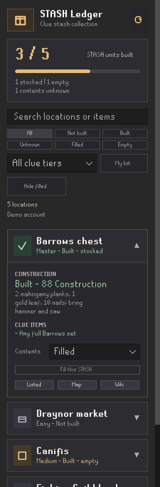

# STASH Ledger

STASH Ledger is a compact RuneLite sidebar for planning every STASH unit. It
keeps construction progress and confirmed contents separate, so an unavailable
scan never becomes a false “empty” result.



## Features

- Browse all 119 STASH units across Beginner through Master clue tiers.
- Filter by construction state, filled/empty contents, tier, location, or clue
  item; hide filled units while keeping unknown contents visible.
- Expand a location card for construction materials and exact clue requirements.
- Scan construction after login, a build, or a manual refresh.
- Read saved contents from Watson's noticeboard or explicitly confirm contents
  for a built unit. Confirmed STASH Search interactions also update filled/empty
  state automatically. Unknown contents are distinct from empty.
- Mark needed clue items with a gold dot in inventory, bank and equipment,
  including item variants. These are planning hints, not owned-item counts or
  proof that an alternative equipment requirement is satisfied.
- Keep a profile-scoped shortlist; logout and account changes clear visible
  account state.
- Show all STASH locations on the world map, optionally hiding confirmed filled
  units, or select one location from its card. Map tooltips explain unknown,
  not-built, empty and filled states. Open RuneLite's general STASH Wiki page.

Settings let you turn item highlighting, automatic interaction tracking and
map markers on or off. The plugin never moves a character or uploads account data.

Construction uses RuneLite's Watson STASH check script. Contents are the last
confirmed noticeboard, interaction or manual state, not a live inventory scan.
Interaction updates require a matching STASH object and location, the exact
game success message, the same account, and a player still near that STASH.
Open Watson's noticeboard to reconcile contents you changed outside this client.

## Development

The project targets Java 11 bytecode and pins RuneLite `1.13.6`. A development
launcher is available in the `-all.jar` artifact:

```sh
java -ea -jar build/libs/stash-ledger-0.1.0-all.jar --developer-mode --debug
```

On macOS, the development launcher also needs this JVM option:

```text
--add-opens=java.desktop/com.apple.eawt=ALL-UNNAMED
```

`-ea` is required by RuneLite's development-plugin loader. The small JAR is the
plugin artifact; it is not a Plugin Hub installation mechanism.

To build and test in a suitable development environment:

```sh
./gradlew test jar shadowJar
```

The test suite covers account boundaries, tracking, catalog data, filters and
the real 225px Swing layout. Source-only negative checks prove key guards fail
when removed and pass after exact restoration. See [validation evidence](docs/validation.md)
for the tested commit and remaining live checks.

## Catalog, licensing, and Hub status

The catalog retains exact source clue wording, alternatives, and restrictions;
it does not guess interchangeable items. See [catalog provenance](docs/catalog-provenance.md),
[third-party notices](THIRD_PARTY_NOTICES), and [license](LICENSE).

`runelite-plugin.properties` declares version `0.1.0`. Plugin Hub submission is
being prepared; installing the development client does not make this plugin
available in a normal RuneLite installation. Hub availability requires RuneLite
review and acceptance.
