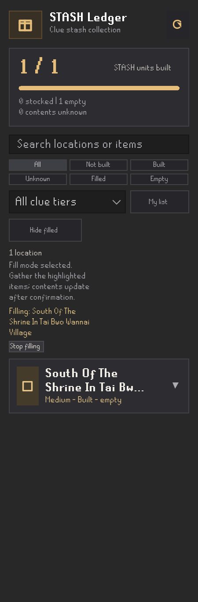

# Version 0.1.3 validation

Validated on the guarded NAS Linux worker on 2026-11-12 against RuneLite 1.13.6.
Exact source: `82a5fa999df7270623a5ebf328450a9abd2372e5`. Subsequent documentation
and merge commits retain the same executable, test and build inputs.

- 114 Java tests passed with zero failures, errors or skips; seven Python tests
  passed. Java 17 built Java 11 bytecode.
- All 49 Java and two Python source-only checks failed their named tests after
  removing the relevant source guard, then passed after exact byte restoration.
  Restored source hashes match the committed candidate. The full suite passed
  again after all proofs; source and guarding tests remain in separate commits.
- Both JARs built. Packaged metadata and notices match source, and the development
  JAR reached RuneLite's headless option parser with assertions enabled.
- Both actual Swing sidebar fixture renders were visually inspected. Automated
  dot tests check configured colors, order, deduplication, live config reads,
  six separate dots inside 24px and 32px item bounds, and all-tier hover text.
- Independent exported-artifact verification reconciled the sealed source,
  JUnit reports, named proof logs, hashes, metadata and commit separation.
  Server archive checksums and retirement of the exact build workspace passed.

Verified fleet ticket: `vps-5ddaf8aa8bf3436abcbf3a7e2bbe8856`.

```text
474c3463071fa6157626dd929ddd2d83b88a77e3bddf5c002e75a5e474e1f102  stash-ledger-0.1.3.jar
993c9fe20e3707b838f5dfc7d06937aa335e8a7cb98d2452d113e9c1ba8905be  stash-ledger-0.1.3-all.jar
```

The new diagnostic tests preserve previous contents when the final tier fails,
check bounded tier-specific failure messages and their account/board reset, and
retain the distinction between a malformed board and unavailable save/construction
state. Explicit line-break markup now keeps word boundaries; whether the live
board uses that markup has not been captured, so this is not a claim that the
reported 0.1.2 failure is resolved.

Live bank dots/hover and a successful Watson noticeboard sync are still unverified
for this candidate. The maintainer explicitly chose to publish the tested update
and perform those checks on the live release. The noticeboard changes improve
normalization and diagnostics; they are not a claim that the reported live error
has been resolved. No gameplay automation or saved-data migration was added.

---

# Version 0.1.2 Watson noticeboard correction

The live noticeboard pilot exposed a catalog-generation bug: ordinary entries used
friendly display names instead of the reference enum's Watson labels. For example,
`Canifis` did not match `Centre of Canifis`. The correction regenerates 69 aliases,
retaining all 119 units, explicit label overrides and the tier-scoped Warriors'
Guild exception. The parser's complete-snapshot rule is unchanged.

Executable/test candidate: `718bac6804463e99002f8a390b0d520754034c20`.
Validated on the guarded Windows Linux worker on 2026-11-12: 97 Java tests and
7 Python tests passed, with zero failed, errored or skipped Java tests. All
36 Java and 2 Python source-only guard removals failed their named tests; exact
source bytes were restored and the guards passed, followed by the full Java suite.
Both JARs, headless launcher help and packaged notices/metadata passed.

The new independent 119-row board-label fixture covers all six tiers and mixed
zero/one/two checkmarks. Generator guards cover the default wrapper enum name,
explicit board-name overrides, a differing linked RuneLite ID, and the two
Warriors' Guild IDs. Existing punctuation normalization coverage is retained.

```text
602f35375c9666487ec7a2b43d5e45dd26c24793a5d30326aa28a6c72f7ab24f  stash-ledger-0.1.2.jar
c67af77a0b92d1bddeb7479cf13668de913104293b6cbf8d2e42a85d3e5bc130  stash-ledger-0.1.2-all.jar
```

Version 0.1.2 publication was verified on 2026-11-12 at 23:05 UTC. Hub PR20592
merged as `b87a78f32f785ddc77f60f5cefec5aa3093ebf8f`, pinning
`0e901f1d340f7ca0fc50a68e51b0a3ca5fb058a0`. Production build/upload run43322283813
passed. The signed official manifest lists0.1.2 with a108947-byte JAR, SHA256
`2609ad81b15de7625a6ba871211a10fcfcb3d51ff8baed8f5a0c574f6b0489de`.
All reviewed archive entries match except the generated update timestamp.

The user reports the same noticeboard failure after updating. Successful live
sync remains unverified; the original alias correction is not sufficient evidence
that the complete live interface works. The next candidate adds diagnostics to
identify the remaining failure without accepting partial or unknown board data.

---

# Version 0.1.1 validation

Validated on 2026-11-11 local (2026-11-12 UTC) against RuneLite 1.13.6.
Executable and test candidate: `3fee9c790ccbe55cf539df481cae4cb249c69141`.
Subsequent documentation commits do not change executable inputs.

- 96 Java tests passed, with zero failures, errors or skips. Six Python catalog
  tests passed. Java 17 built Java 11 bytecode.
- All 35 named source-only regression proofs failed when their guard was removed
  and passed after exact byte restoration. Each source hash was checked against
  the candidate commit. The final complete suite ran again after all proofs.
- New coverage verifies single-STASH eligibility and account boundaries, queued
  stale clicks, completion/logout cleanup, destination deduplication across item
  variants, real outline pixels, hover menu/drag/pointer restrictions, bounded
  hover details, and sidebar selection/stop callbacks.
- Both plugin and runnable JARs built; the runnable JAR passed headless launcher
  help with assertions enabled. Packaged notices and plugin metadata match source.
- The actual Swing sidebar rendered at 225px width in its normal and selected
  fill states. The longest real catalog name and full fill instructions fit,
  including the Stop control. Both final renders were visually inspected.

A speculative status-height change was withdrawn after two actual negative
checks disproved the concern. The stronger preferred-height and containment test
remains; the unsupported mutation was removed with an explicit commit reason.
No test assertions were weakened. Those first two runs were not release passes.

Verified fleet ticket: `vps-f17c10edb8264cdaa53ce2ab62ed3a35`.
The exported source receipt, artifact hashes and completed archive/retirement
were checked. Source and guarding tests are in separate commits.

```text
e7cc5f17cd44e9873678c03958080603049f7ed6fa09c0ead2d57e3f03e8eb45  stash-ledger-0.1.1.jar
53e187c3098aa0105e1f5cfa93723ae92655d8acb8345afff4b249b51cba03de  stash-ledger-0.1.1-all.jar
```

[Plugin Hub PR 20555](https://github.com/runelite/plugin-hub/pull/20555) pins
`a81540cc2b7b32f7742cdd40165871fd53afe08b`. Its source CI
[43165496739](https://github.com/wyattf1995/runelite-stash-ledger/actions/runs/43165496739)
and official Hub build
[43165622919](https://github.com/runelite/plugin-hub/actions/runs/43165622919) passed.
All 21 Java source files in the Hub build archive match the pin; its JAR matches
the CI manifest hash and size.

PR 20555 merged at 2026-11-12 07:15:27 UTC as
`f4061c789fa7bd3f6e83565c85d49574794e3f73`. The
[production build and upload](https://github.com/runelite/plugin-hub/actions/runs/43173919901)
succeeded, completing upload at 07:16:22 UTC. At 10:13:24 UTC, the official
RuneLite 1.13.6 signed manifest listed STASH Ledger 0.1.1. Its RSA/SHA-256
signature and downloaded JAR hash/size were verified:

```text
92839bc32532d3ed1acfce7e62acf34569ac8b703a00671c9eac6c40f231a906  published JAR (108735 bytes)
```

The production CI manifest diff matches that JAR. All 61 archive entries match
the reviewed build except the generated `runelite_plugin.json` lastUpdatedAt
value; every compiled class and other resource is identical. Version 0.1.1 is
now officially distributed through Plugin Hub.

The new bank outlines, hover and fill mode have automated coverage; a live
in-game bank/contents/account-switch pilot has not been performed. Existing
live checks listed below apply to the earlier candidate only.



---

# Version 0.1.0 historical validation

Validated 2026-11-11 against RuneLite 1.13.6. Official Plugin Hub distribution
was verified on 2026-11-12 UTC after the submission was merged.

Validated code and test commit: `a26d83be33e426264e2e1349ea713c2833984a05`.
The following documentation update does not change executable inputs.

- 78 Java tests passed with zero failures, errors or skipped tests on Java 17,
  targeting Java 11 bytecode. Six Python catalog-generator tests passed.
- 24 named source-only checks failed after removing the relevant guard, then
  passed after restoring the exact source bytes. These cover complete scans,
  account/session boundaries, Watson parsing, built-only contents edits, sidebar
  geometry and font support, filters, map visibility, confirmed interactions,
  item highlighting, source-declared item exclusions, every physical STASH
  location, and stop/restart interleavings across the EDT and client thread.
- Six generator tests cover source parsing and catalog output. Four additional
  generator guards were independently proved on the previous candidate; those
  historical proofs are retained separately from this candidate's 24 checks.
- Both plugin and runnable JARs built successfully. The runnable JAR reached
  RuneLite's `--help` handler with assertions enabled in a headless process.
- Packaged license, third-party notices and metadata match source files exactly.
- The actual Swing sidebar rendered with RuneLite's look and feel at 225 x 680
  logical pixels, captured at 2x scale. Its geometry and font tests passed and
  the resulting image was visually inspected. The preview uses demo account data.
- Catalog/Watson checks cover all 119 logical units, 121 physical coordinates,
  and all six clue tiers, including
  the two Warriors' Guild bank entries. Item tests preserve explicit alternatives
  and exclusions, including excluding the inactive Bow of Faerdhinen.

Artifact SHA-256 values:

```text
37db3083e89b957da34a1a947e263bf54f5a7408343c4fa57ba8a2a1871d4f6c  stash-ledger-0.1.0.jar
eb3ed99a835bd16be263face495b383d79de35720e282b62ee513dc7b38693d6  stash-ledger-0.1.0-all.jar
```

The retained validation bundle includes test XML, logs, source hashes for every
red/green proof, both JARs, the rendered sidebar and an archive/checksum receipt.
Evidence collection passed on the original fleet ticket
`vps-1097480b6acb4c5083907b2491493a28`. The source receipt and exported checksums
were independently verified. Source and guarding tests were committed separately.

## Official distribution

[Plugin Hub PR 20516](https://github.com/runelite/plugin-hub/pull/20516) merged
at 2026-11-12 00:36:41 UTC. Its descriptor pins reviewed source
`c579b19a5cab11595127b4a0197cb893ac419903`, which differs from the validated
candidate only by documentation and merge history. The
[production build and upload](https://github.com/runelite/plugin-hub/actions/runs/43128542665)
succeeded, completing upload at 00:37:39 UTC.

At 04:12 UTC, the official RuneLite 1.13.6 manifest contained exactly one
`stash-ledger` display entry and one JAR entry, version `0.1.0`. Its RSA/SHA-256
signature was verified with RuneLite's pinned certificate. The downloaded JAR
matched the signed manifest and production CI manifest diff in hash and size:

```text
8fed51321c2d9b37c5bc3f4576f65751398824257b07f41d99c14a2a5d5278da  published JAR (101281 bytes)
```

All compiled classes and other resources match the reviewed pull-request build.
Only generated `runelite_plugin.json` creation/update timestamps differ. The
development launcher is excluded. Publication does not imply that the remaining
live checks below have been performed.

## Comprehensive review fixes

The review covered account isolation and persistence, construction/Watson scans,
interaction confirmation, catalog/item data, overlays, map ownership, Swing/EDT
behavior and the build/packaging pipeline. Two confirmed defects were fixed:

- The generated catalog discarded alternate positions for Lumbridge Swamp Caves
  and the cavern under the whirlpool. All source-defined positions now participate
  in marker ownership, exact interaction matching and proximity checks; progress
  remains one entry per logical unit.
- Plugin shutdown on the EDT could clear markers while an already-running client
  callback continued adding them. Initialization and cleanup now run in client
  queue order, with immediate lifecycle invalidation and a stop-during-init guard.
  Deterministic tests cover refresh/stop, rapid restart and stop during startup.

## Live validation scope

The prior development client was successfully installed and signed in on macOS.
A user screenshot confirms the active sidebar and a completed construction scan
showing 50 of 119 built, with 50 contents unknown. The count has not been
independently reconciled against the account.

The previous candidate (`26d9622`) was restarted and its corrected live UI was
confirmed by the user and a private screenshot: clean icons, wrapped titles,
search prompt and Filled/Empty controls. The latest review candidate still needs
a live restart. Interaction tracking, alternate positions, item/map markers and
account switching need an in-game pilot. Watson noticeboard synchronization has
automated coverage but its live check was deferred because the user could not
reach Watson. These are explicit gaps, not claimed live passes.
